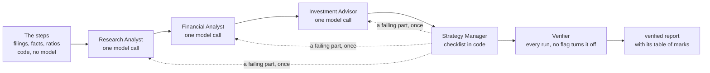

# FIN 67110 equity research desk

The desk of Francis & Zhang (2026), Section 3.1, for any U.S. company that files with SEC EDGAR.
A ticker goes in. The desk finds the latest 10-K, 10-Q and earnings release, reads the statements
as XBRL data, computes the core ratios in code, and four roles write a five-part report.
Nothing in the code names a company: the ticker is an argument.

- `team.py`: the agent team (Lab 04), a LangGraph graph in code with a Verifier on every run.
- `verifier.py`: the Verifier, which checks every sourced number in a report against the saved filings and facts.
- `roles/`: each role's instructions, one file per role.
- `lab02_desk.py`: the seven steps, from SEC EDGAR, with no model.
- `lab03_app.py`: the seven steps, then the four roles of Figure 1 on Anthropic's API or Google's Gemini API, then the report.
- `prices.py`: a closing price for P/E, from financialdatasets.ai.
- `check_env.py` and `set_keys.py`: check the setup, and save pasted settings into `.env`.

## The agent team



The order is the same on every run, and code decides every edge. A role the Manager sends back
returns to the Manager, and no role runs more than two times in one run. Each role receives only the
JSON the graph gives it: the task, the context and the expected output.

## Setup

You need Python 3.11 or newer and one model key: an Anthropic key (it starts with `sk-ant-`) or a
Google AI Studio key (it starts with `AIza`). The key picks the provider. The seven steps alone
(`lab02_desk.py`) need no model key.

1. Get the code, and open a terminal in its folder:

   ```
   git clone https://github.com/gkotsivi-ui/equity-analyst-project.git
   cd equity-analyst-project
   ```

   Without git: on the GitHub page, click Code, then Download ZIP. Unzip it, and open a terminal in the unzipped folder.

2. Install the packages. On Windows (if `python` is not found, type `py` in its place in every command):

   ```
   python -m pip install -r requirements.txt
   ```

   On a Mac, in a virtual environment. Type `python3` to make it; in each new terminal, run the `source` line again:

   ```
   python3 -m venv .venv
   source .venv/bin/activate
   python -m pip install -r requirements.txt
   ```

3. Make `.env` and fill it in. Run `python set_keys.py` and paste each value at its prompt, or copy the
   example (`copy .env.example .env`; on a Mac, `cp .env.example .env`) and edit it in a text editor.
   `.env` is never committed.

4. Check the setup. Each line says `ok`, `note` or `FIX`, and a `FIX` line says what to do:

   ```
   python check_env.py
   ```

| Setting | Needed for | Value |
|---|---|---|
| `SEC_USER_AGENT` | every step | your name and email; EDGAR requires it on every request |
| `API_KEY` | the roles and the Verifier | an Anthropic key from platform.claude.com (`sk-ant-...`), or a Google AI Studio key from aistudio.google.com (`AIza...`) |
| `MODEL`, `EFFORT` | optional | the model for the roles; defaults `claude-opus-5-5` for an Anthropic key and `gemini-3.8-flash` for a Google key. `EFFORT` (default `medium`) applies to Anthropic models |
| `FINANCIAL_DATASETS_API_KEY` | optional | the key for closing prices; without it, pass `--price` |
| `AI_TOOLS` | optional | the AI tools named on each report's AI-assistance line |

## Run

The agent team, with the Verifier on every run (Lab 04):

```
python team.py COST --peers WMT,TGT,BJ --price 992.13
python team.py --verify-only output/COST_20261103_084759_seeded_eps
```

The node names print in the graph's order, then the path of the verified report. `--verify-only` runs
the Verifier on a saved run and nothing else.

The seven steps only (Lab 02):

```
python lab02_desk.py COST --peers WMT,TGT,BJ --price 992.13
python lab02_desk.py COST --step 4
```

The seven steps, then the four roles and the report (Lab 03):

```
python lab03_app.py AAPL --peers MSFT,GOOGL,DELL
python lab03_app.py COST --peers WMT,TGT,BJ --price 992.13
```

992.13 is Costco's close on Oct 27, 2026, the price the Lab 03 report used. For another company, give
its close, or leave out `--price`.

Expect the seven steps, then the four role names, then the path of the report. Without `--price`, the
desk uses the last close before the release was accepted, from financialdatasets.ai. One close by date:

```
python prices.py COST 2026-10-27
```

Each run writes `output/<TICKER>_<date>_<time>/`:

| File | What it holds |
|---|---|
| `10K_*.txt`, `10Q_*.txt`, `8K_*.txt` | the three documents as plain text; the 8-K file is Exhibit 99.1, the earnings release |
| `facts.json`, `ratios.json`, `peer_facts.json` | each fact with its tag, period and filing; each ratio with its arithmetic |
| `report.md` | the five-part report; line 1 names the filings and their accession numbers, line 2 the run time |
| `verified_report.md`, `verification.json` | the report with the Verifier's table of marks under its first line (Lab 04) |
| `nodes/` | each node's input and output, numbered in the order the nodes ran (Lab 04) |
| `roles.json` | every JSON hand-off between the Strategy Manager and the roles (Lab 03) |
| `audit.md` | a blank audit table for the human sign-off |

## When a run does not start

Run `python check_env.py` first. It checks Python, the packages, `.env`, SEC EDGAR and the model key,
and each `FIX` line says what to do.

| What you see | What to do |
|---|---|
| `There is no .env file` | Make `.env` in the repository folder (Setup, step 3), and run the commands from that folder. If Windows saved it as `.env.txt`, rename it to `.env`. |
| `API_KEY ... is an OpenAI key` | The roles run on Anthropic or Google. Use a key that starts with `sk-ant-` or `AIza`. The seven steps (`lab02_desk.py`) need no model key. |
| `ModuleNotFoundError: No module named 'langgraph'` (or `anthropic`, `requests`) | Install with the same Python that runs the desk: `python -m pip install -r requirements.txt`. On a Mac, run `source .venv/bin/activate` first. |
| `error: externally-managed-environment` | Make the virtual environment first (Setup, step 2, Mac). |
| `python` is not found, or the Microsoft Store opens | On Windows, type `py`. On a Mac, type `python3`. |
| `The '<' operator is reserved` or `no such file or directory: close` | A placeholder was typed as is. Give a number: `--price 992.13`. |
| `SEC request failed: 403` | `SEC_USER_AGENT` needs your own name and email. |
| `credit balance is too low` | Add credit to the Anthropic account at platform.claude.com, or use a Google AI Studio key. |
| `The Gemini API is limiting this key` | Wait a minute and run again, or set `MODEL=gemini-3.5-flash-lite` in `.env`. |

## Reports in this repository

| Company | Report | What it read |
|---|---|---|
| Microsoft (MSFT), the partner's pick for Checkpoint 1 | [output/MSFT_20261101_182330/report.md](output/MSFT_20261101_182330/report.md) | FY2026 10-K, Q1 FY2027 10-Q, and the Oct 28, 2026 earnings release |
| Costco (COST), the Lab 03 known answer, at the Oct 27, 2026 close of $992.13 | [output/COST_20261101_201319/report.md](output/COST_20261101_201319/report.md) | FY2026 10-K, Q3 FY2026 10-Q, and the Sep 24, 2026 earnings release |

## How the numbers are kept honest

1. Step 2 reads each filing's "Accepted" time from its EDGAR index page, in Eastern time. The earnings
   8-K is the newest 8-K that reports Item 2.02; newer 8-Ks without it are printed as skipped.
2. Step 4 reads full fiscal years only. When a concept has several candidate tags, the tag whose
   latest year is newest wins; a tie goes to total revenues (`Revenues`) before net sales. Every
   concept is read for revenue's fiscal year, and step 4 prints whether every period end equals the
   10-K's fiscal year end.
3. Step 5 is the calculator. Debt includes its current portion; return on equity uses average equity.
4. Step 6 prints the release's revenue and diluted EPS lines as the release states them.
5. The Strategy Manager is a checklist in code. It sends each analyst only its JSON packet. It checks
   that each Research Analyst quote appears word for word in the filings, and that each Financial
   Analyst number appears in the data the desk gave it. It runs requested ratios in code and sends a
   failing part back to its role once. Problems that remain are listed at the end of the report.
6. With an Anthropic key, the roles run on Claude Opus 5.5 with Anthropic's server-side fallback,
   which re-runs a declined request on another model. With a Google AI Studio key, they run on
   Gemini 3.8 Flash in JSON mode. `roles.json` records which model served each call.
7. The Verifier receives only the compiled report, the saved filing texts and the saved facts. It
   skips the Investment Advisor's thesis. A model lists each number with the source the report gives
   it. Code then checks each one: a number sourced to an XBRL tag and period against the facts file;
   a quoted line against the filing text, allowing for spacing and formatting; a ratio by recomputing
   its arithmetic. A model then checks that each quoted line states that number for that period, in
   that definition. Each number is marked correct, wrong or unsupported. A number with no source is
   unsupported, unless it repeats a number the report sources elsewhere. A wrong number is corrected
   from the filings, with the real line or tag beside it.

## Tests

```
python -m unittest discover -s tests
```

The tests need no network and no key. They cover the tag trap, the full-year filter, the table text,
the quote and number checks, the calculator, and a full Strategy Manager run against a fake model.
For the setup, they check how `.env` is read, the key checks, and the Gemini path against a fake reply.
For the agent team, they check the fixed node order, the single send-back, and that every path to the
end runs the Verifier with no option to turn it off. They also check the Verifier's marks on a seeded
EPS, an invented growth rate, a price and an unsourced number.

This is a learning exercise, not financial advice.
AI assistance: Claude Code. I verified the sources myself; the judgments are mine.
Any remaining errors are my own.
